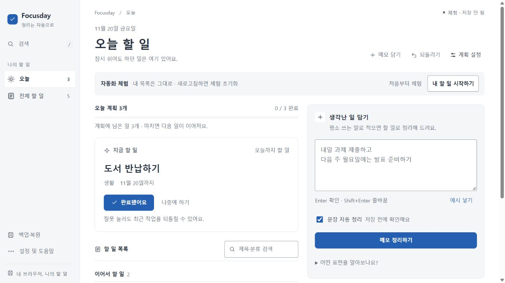
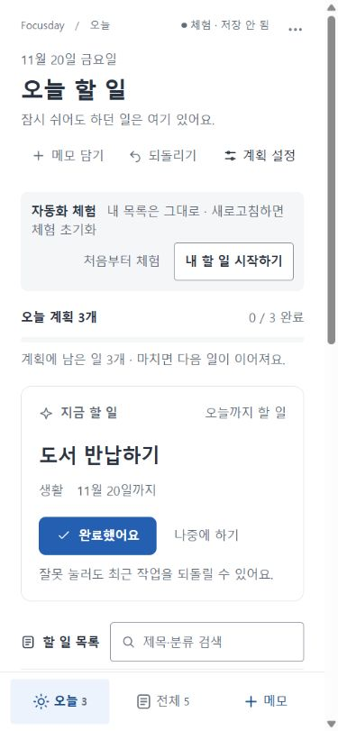

# Focusday · 개인용 할 일 관리 자동화

**할 일 정리부터 미루게 된다면, 생각난 말 그대로 담아 보세요.**

메모를 할 일로 나누고, 오늘 할 분량을 고르고, 하나를 마치면 다음 일을 보여줍니다. 새로 적은 오늘 기한도 계획에 반영하며, 오늘까지 해야 할 일이 남아 있으면 마무리 전에 알려줍니다.

> **[30초 자동화 체험](https://gsj118.github.io/focusday/?demo=1)** · **[내 할 일 시작하기](https://gsj118.github.io/focusday/)**
> 설치·가입 없이 브라우저에서 바로 사용합니다. 먼저 예시 메모를 정리하고, 하나를 완료한 뒤 되돌려 보세요.



설치·회원가입·API 키 없이 사용하는 웹 앱입니다. 체험은 예시 5개로 시작하며 개인 목록과 분리됩니다. 새로고침하면 체험만 처음 상태로 돌아갑니다.

## 30초 동안 이렇게 써 보세요

1. **예시 넣기 → 메모 정리하기**를 누릅니다. 다음 메모가 세 가지 할 일과 날짜로 정리됩니다.
2. 제목은 바로 고칠 수 있고, 날짜·분류 옆 **수정**을 누르면 속성을 바꿀 수 있습니다. **3개 담기**로 저장하면 오늘 기한의 빨래가 기존 오늘 계획에 추가되어 4개가 됩니다. 내일·다음 주의 새 항목은 전체 목록에 담깁니다.
3. **지금 할 일 → 완료했어요**를 누릅니다. 다음 일이 이어지고 완료 수가 올라갑니다.
4. 오늘 계획의 네 가지를 마치면 **오늘 분량을 다 마쳤어요**가 표시됩니다. 잘못 누른 동작은 상단 **되돌리기**로 복구합니다.

```text
오늘은 빨래 돌리고 내일 과제 제출해야 돼.
다음 주 월요일 발표 준비도 해놔야 하고.
```

| 정리 결과     | 기한           | 제안 분류 |
| ------------- | -------------- | --------- |
| 빨래 돌리기   | 오늘           | 생활      |
| 과제 제출하기 | 내일           | 학교      |
| 발표 준비하기 | 다음 주 월요일 | 학교      |

실제 날짜는 사용하는 날을 기준으로 계산합니다. 문장 해석이 다르면 저장 전에 수정하거나 **문장 자동 정리**를 끄고 원문으로 담을 수 있습니다.

‘내일 과제 제출하고 우유 사기’처럼 지원하는 행동 연결도 나눕니다. 같은 문장의 날짜를 함께 적용하면 확인 안내를 보여줍니다. 메모를 쓰던 중 예시를 눌러도 원문은 남기고 뒤에 덧붙입니다.

## 무엇을 자동화했나요?

| 직접 해야 했던 일                            | Focusday에서 달라진 동작                                                                           |
| -------------------------------------------- | -------------------------------------------------------------------------------------------------- |
| 메모를 항목으로 나누고 날짜·분류를 채우기    | 지원하는 한국어 표현을 읽어 할 일과 속성을 제안합니다.                                             |
| 오늘 할 일을 매일 다시 고르기                | 기한·이전 선택·우선순위를 보고 기본 3개를 고릅니다. 1·3·5개로 바꿀 수 있습니다.                    |
| 하나를 마친 뒤 다시 목록을 훑기              | 정한 계획 안에서 다음 할 일을 바로 보여줍니다.                                                     |
| 끝내도 계속 늘어나는 목록 관리               | 완료한 자리를 다른 일로 채우지 않습니다. 새로 입력한 오늘 기한은 놓치지 않도록 계획에 추가합니다.  |
| 잘못 추가·수정하거나 계획을 바꾼 뒤 수습하기 | 최근 작업의 할 일 상태와 오늘 계획을 함께 되돌립니다. 메모 추가를 되돌리면 입력 원문도 복구합니다. |

**정리 → 선택 → 실행 → 마무리 → 복구**를 한 흐름으로 연결했습니다. 관리 기능을 많이 설정하기보다, 일단 담고 하나씩 끝내는 사람을 위한 구성입니다. 이 사용성은 설계 목표이며 실제 사용자 연구 결과로 주장하지 않습니다.

## 자동으로 골라도 내가 바꿀 수 있어요

- 오늘 계획 밖에도 기한이 지난 일이나 오늘까지 할 일이 남아 있으면 **오늘까지 할 일이 남아 있어요**를 표시하고 바로 오늘 계획에 넣을 수 있습니다. 이때는 전체 마무리를 안내하지 않습니다.
- **나중에 하기**는 오늘 순서에서 잠시 건너뜁니다. 기한이나 완료 상태를 바꾸지 않습니다.
- 새 메모의 오늘 기한·지난 기한은 오늘 계획에도 자동 반영하고, 기한이 급한 순서로 보여줍니다. 추가되는 오늘 일의 수를 저장 전후에 안내합니다. 기존 계획에 새 내일·다음 주·무기한 항목까지 넣으려면 **모두 오늘 할 일에 넣기**를 선택합니다.
- 기존 일의 기한을 오늘이나 지난 날짜로 바꿀 때도 오늘 계획에 넣습니다. 편집창에서 직접 빼는 선택은 유지합니다.
- 끝난 뒤 **하나 더 하기**, **계획 설정**, **오늘에 넣기/빼기**로 계획을 직접 조정할 수 있습니다.
- 저장 전 **취소**는 편집을 적용하지 않습니다. 저장 후 **되돌리기**는 최근 적용한 작업 한 건을 복구합니다. 알림은 기본 8초지만 상단 버튼은 다음 작업이나 새로고침 전까지 남습니다. 날짜가 바뀌면 이전 계획 변경의 되돌리기는 끝나며, 완료·삭제·추가·편집 취소는 새 날짜의 계획을 덮어쓰지 않고 처리합니다.
- 정리 결과를 열어 둔 채 날짜가 바뀌면 **기한을 확인한 뒤 저장**합니다. 수정한 제목·기한을 지우거나 ‘내일’을 몰래 다시 계산하지 않습니다.
- **자동 계획**과 **문장 자동 정리**를 각각 끄고 직접 관리할 수도 있습니다.

## 화면도 작업 흐름에 맞췄습니다

왼쪽에는 오늘의 분량과 지금 할 일, 오른쪽에는 넓은 메모 공간을 배치했습니다. 파란색은 주요 실행 버튼, 초록색은 완료, 주황색은 기한 확인에 씁니다. 모바일에서는 하단 **메모**로 입력창에 바로 이동하고 **오늘·전체**로 목록 맨 위에 돌아갑니다. 긴 정리 결과는 안쪽에서 스크롤하므로 저장 버튼을 찾기 쉽습니다.

참조 화면에서 실제 색·글자·입력·버튼 스타일을 측정하고, 공통 기준을 `src/tokens.css`로 모았습니다. 측정한 자료는 제3자의 Notion 분석 화면이며 공식 앱에서 추출한 토큰으로 소개하지 않습니다. 공식 작업 화면은 목록·속성 배치를 시각적으로 비교하는 데 사용했습니다. [참조 → 토큰 → 컴포넌트 적용 근거](DESIGN.md)



## 데이터와 자동화의 범위

개인 목록은 **현재 브라우저에 자동 저장**합니다. 서버 전송, 로그인, 클라우드 동기화, 자동 백업은 없습니다. 다른 기기로 옮기려면 **백업·복원 → 백업 파일 다운로드**를 사용합니다. 파일에는 모든 할 일 속성이 포함되고 문구 설정·오늘 계획은 제외됩니다. 최대 크기는 10MiB입니다.

메모 정리는 **브라우저에서 실행하는 한국어 규칙 기반 처리**입니다. 생성형 AI API를 호출하지 않습니다. 오늘·내일·모레, 요일, 다음 주 월요일, 11월 23일, 3일 뒤 등 지원하는 표현을 읽습니다. 분류는 키워드로 제안하므로 문맥에 따라 틀릴 수 있습니다. 반복 일정·시간 알림은 만들지 않으며 모호한 표현은 제목에 남겨 확인을 요청합니다.

기존의 검색, 상세 편집, 완료 목록, 오늘의 한 문장, 격려, 백업 미리보기·합치기·전체 교체, 저장 오류 복구도 유지했습니다. [정확한 동작과 제한](docs/product-spec.md)

## AI 활용 과정

「인공지능활용실습」 과제로 AI 코딩 도구를 요구사항 분석, 디자인 참조 비교, 자동화 규칙 구현, 한국어 문구 검수, 테스트와 오류 수정에 활용했습니다. 앱에 AI 모델을 넣은 프로젝트와 AI를 제작에 활용한 프로젝트를 구분해 설명합니다. [AI 활용 기록](docs/ai-workflow.md)

## 실행과 검증

코드를 수정할 때는 Node.js 24 이상과 프로젝트 지정 pnpm 11.19.0을 사용합니다.

```powershell
git clone https://github.com/gsj118/focusday.git
cd focusday
pnpm install --frozen-lockfile
pnpm dev
```

```powershell
pnpm check       # 타입·lint·단위·서울/뉴욕 날짜·production build
pnpm test:e2e    # production 앱 브라우저 검사
node scripts/audit-korean-copy.mjs  # 한국어 문자열 목록 갱신
```

기능·화면·한국어 검수와 회귀 검사 결과는 [검증 기록](docs/validation.md)에 정리했습니다. 최신 배포와 이전 공개 버전의 이력은 [배포 기록](docs/deployment.md)에서 구분해 확인할 수 있습니다.

교수·학생·잦은 계획 변경·작은 화면의 네 관점으로 실제 앱을 조작하고 발견한 문제를 고쳤습니다. 같은 에이전트가 수행한 가상 시나리오이며 사람 대상 사용성 조사와 구분합니다. [페르소나별 관찰과 수정](docs/SYNTHETIC_BETA_V1_5.md)

메모 작성부터 자정·다음 주·완료·삭제·되돌리기까지 연결한 후속 검수도 수행했습니다. [날짜와 복구 시나리오](tests/e2e/lifecycle.spec.ts)에는 편집 중 날짜 변경, 한글 조합, 연말·윤년·일광절약시간 경계를 포함합니다.

| 코드                                                                     | 역할                                      |
| ------------------------------------------------------------------------ | ----------------------------------------- |
| [src/memo.ts](src/memo.ts)                                               | 한국어 메모 분리·날짜 인식·분류 제안      |
| [src/automation.ts](src/automation.ts)                                   | 오늘 분량 고정·후보 선택·계획 변경        |
| [src/history.ts](src/history.ts)                                         | 최근 변경만 선택적으로 되돌리기           |
| [src/components/CaptureComposer.tsx](src/components/CaptureComposer.tsx) | 원문·확인·수정·일괄 저장                  |
| [src/tokens.css](src/tokens.css)                                         | 색·서체·간격·폭의 공통 기준               |
| [tests/e2e/v1.5.spec.ts](tests/e2e/v1.5.spec.ts)                         | 새 자동화 흐름·복구·체험 격리·반응형 검증 |

[변경 기록](CHANGELOG.md) · [이전 공개 태그](https://github.com/gsj118/focusday/tags)
