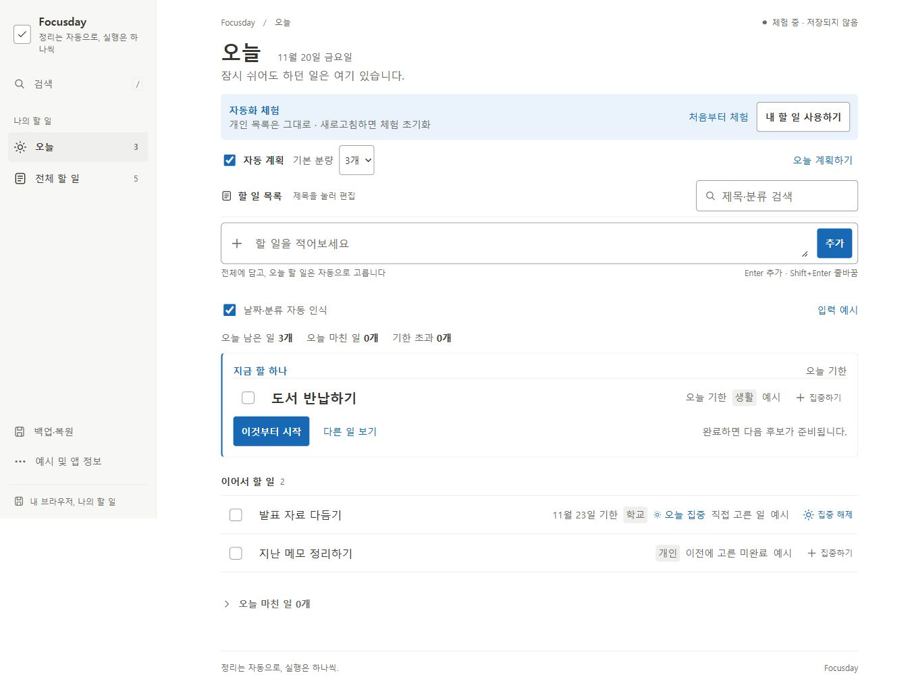
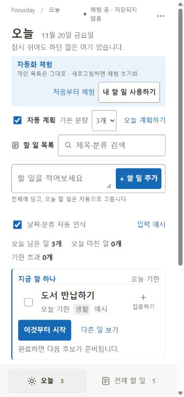

# Focusday · 개인용 할 일 관리 자동화

**할 일은 적기만 하세요. 오늘 할 일과 다음 순서는 Focusday가 정리합니다.**

할 일 관리는 하고 싶지만, 매번 날짜를 지정하고 목록을 정리하는 과정이 번거로운 사람을 위한 웹 앱입니다. 입력 → 오늘 목록 → 다음 행동을 연결해 관리에 필요한 선택을 줄였습니다.

### [▶ 자동화 바로 체험하기](https://gsj118.github.io/focusday/?demo=1)

**설치·회원가입·API 키 없이 바로 열립니다.** 예시 5개로 시작하며, 개인 목록을 건드리지 않습니다. 새로고침하면 체험이 초기화됩니다.

[내 할 일로 사용하기](https://gsj118.github.io/focusday/) · **v1.5.0** · [변경 기록](CHANGELOG.md)



공개 사이트의 실제 체험 화면입니다. 예시 데이터이며, 생성한 UI 목업이 아닙니다.

## 먼저 이렇게 체험해 보세요

1. **지금 할 하나**에서 추천 이유를 확인하고 **이것부터 시작**을 누릅니다.
2. **이 일 완료하기**를 누르면 오늘 마친 일이 늘고 다음 후보가 준비됩니다.
3. 아래 문장을 입력해 날짜·분류·우선순위 미리보기를 확인합니다. Enter로 등록한 뒤 **전체 할 일**에서 새 항목을 확인할 수 있습니다.

```text
내일 발표 자료 제출 #학교 !높음
```

내 목록을 시작하려면 **내 할 일 사용하기**를 누르세요. 체험 내용은 개인 목록에 복사되지 않습니다.

## 무엇을 자동화했나요?

| 번거로운 작업                              | Focusday의 동작                                                                           |
| ------------------------------------------ | ----------------------------------------------------------------------------------------- |
| 제목을 적고 날짜·분류·우선순위를 따로 설정 | 명시적인 입력 표현을 읽어 속성으로 채웁니다. 등록 전에 결과를 보여줍니다.                 |
| 여러 할 일을 하나씩 등록                   | 여러 줄을 한 번에 붙여 넣습니다. 한 줄에 한 가지씩, 오류가 있으면 전체 등록을 보류합니다. |
| 쌓인 목록에서 오늘 할 일을 다시 선택       | 기한·직접 선택·과거 미완료·우선순위에 따라 오늘 목록을 구성합니다.                        |
| 하나를 마친 뒤 다시 실행 순서를 고민       | **지금 할 하나**에서 다음 후보를 제시합니다. 시작은 사용자가 결정합니다.                  |
| 지난번에 고른 미완료 작업을 다시 옮김      | 이전에 선택했던 미완료 항목을 재추천합니다. 항목을 복제하거나 기한을 바꾸지 않습니다.     |

핵심은 **입력에서 실행까지 이어지는 자동화**입니다. 모든 속성을 먼저 채우거나 매일 목록을 다시 만드는 대신, 할 일을 담아두고 추천된 하나부터 시작할 수 있습니다.

## 자동으로 정리해도, 결정권은 사용자에게

- 자동 계획의 기본 추천량은 **3개**이며 **1·3·5개**로 바꿀 수 있습니다. 완료하면 빈자리를 다음 후보로 채우므로 하루 작업 상한을 뜻하지 않습니다.
- **기한 초과·오늘 기한·직접 고른 일**은 추천량을 넘어도 표시합니다. 시작한 일은 새 급한 일이 추가돼도 유지합니다.
- **다른 일 보기**는 추천 후보만 건너뜁니다. 완료 처리하거나 날짜를 미루지 않습니다.
- **자동 계획을 끄면 수동 모드**를 사용합니다. **날짜·분류 자동 인식**도 끌 수 있습니다.
- 입력은 맨 앞의 `오늘`·`내일`·`모레`·`YYYY-MM-DD`, 맨 뒤의 `#분류`·`!높음`·`!보통`·`!낮음`만 읽습니다. 임의의 자연어를 이해한다고 가정하지 않습니다.



노션 작업 화면에서 참고한 사이드바·속성 목록·얇은 구분선에 Focusday의 자동 실행 흐름을 더했습니다. 기존 CSS 토큰을 점검하고 본문·보조 글자와 상단 간격을 조정했습니다. 노션의 공식 토큰을 자동 추출한 결과는 아닙니다. [토큰과 UI 설계](DESIGN.md)

## 기존 관리 기능도 유지합니다

- 제목·기한·우선순위·분류 편집, 오늘/내일/일주일 뒤 빠른 날짜 선택, 제목·분류 검색.
- 완료·미완료 복원, 완료·삭제 직후 최근 한 건 실행 취소, 오늘 마친 일 확인.
- 오늘의 한 문장과 선택 가능한 격려. 필요하면 각각 끌 수 있습니다.
- 전체 할 일 JSON 백업, 복원 미리보기, id 기준 합치기와 확인 후 전체 교체.
- 저장 실패 안내·재시도, 손상된 원본을 자동으로 덮어쓰지 않는 복구 절차.

## 데이터는 어디에 저장되나요?

개인 모드는 **현재 브라우저의 localStorage**에 저장합니다. 로그인·서버 전송·클라우드 동기화·자동 백업은 없습니다. 다른 기기로 옮기거나 브라우저 데이터를 지우기 전에는 **백업·복원 → JSON 백업 다운로드**를 사용하세요.

체험 모드는 별도의 메모리 저장소를 사용하므로 개인 할 일·문구·자동화 설정을 읽거나 쓰지 않습니다. 체험 변경은 새로고침 때 사라집니다.

백업은 완료·예시·모든 할 일 속성을 포함하며 문구·자동화 설정은 제외합니다. 한도는 UTF-8 **10MiB**이고, 초과하면 부분 파일을 만들지 않고 안내합니다. 완료·삭제의 즉시 실행 취소는 최근 한 건에 대해 기본 8초이며, 이후에도 완료 항목은 전체 목록에서 복원할 수 있습니다. [정확한 저장·복원 규칙](docs/product-spec.md)

## AI를 어떻게 활용했나요?

이 프로젝트는 「인공지능활용실습」 과제로, AI 코딩 도구를 요구사항 정리, 자동화 규칙 설계, 구현, 테스트 작성, 오류 분석과 문서화에 활용했습니다. [AI 활용 과정](docs/ai-workflow.md)

**앱의 자동화는 브라우저에서 실행되는 규칙 기반 로직입니다.** 생성형 AI API를 호출하지 않습니다. 추천 기준을 코드에서 확인할 수 있고 API 비용·키 설정 없이 체험할 수 있습니다.

## 실행과 검증

사이트 이용에는 설치가 필요 없습니다. 아래는 코드를 수정하거나 검증할 때만 사용하는 개발 환경 안내입니다.

Node.js 24 이상, 프로젝트 지정 pnpm 11.19.0. React 19.3.0·TypeScript 5.9.3·Vite 8.3.2와 일반 CSS를 사용하며 기존 lockfile과 의존성을 유지했습니다.

```powershell
git clone https://github.com/gsj118/focusday.git
cd focusday
pnpm install --frozen-lockfile
pnpm dev
```

```powershell
pnpm check         # 타입·lint·단위·시간대·production build
pnpm test:e2e      # production 화면의 브라우저 회귀 검사
node scripts/check-deployment.mjs https://gsj118.github.io/focusday/
```

E2E는 기본적으로 설치된 Chrome을 사용합니다. Chrome이 없다면 `pnpm exec playwright install chromium` 후 PowerShell에서 `$env:PW_CHANNEL='chromium'`을 지정합니다. 공개 주소 검사 스크립트는 HTTP·자산 유형·버전 표식을 검사하며 화면 조작 검사와 구분합니다.

**검증 완료:** 단위 테스트 79개, 서울·뉴욕 시간대 각각 55개, 루트·Pages 경로 브라우저 검사 각각 117개를 통과했습니다. GitHub CI·Pages 검사도 각각 117개 통과 후 실제 공개 화면을 확인했습니다.

검증 결과와 공개 배포 근거는 [검증 기록](docs/validation.md) · [배포 기록](docs/deployment.md)에 정리했습니다. 과거 v1.0~v1.4의 화면·증거는 당시 기록으로 보존합니다.

## 코드와 설계 살펴보기

| 파일                                             | 역할                                           |
| ------------------------------------------------ | ---------------------------------------------- |
| [src/capture.ts](src/capture.ts)                 | 명시적 입력 인식과 여러 줄 검증                |
| [src/automation.ts](src/automation.ts)           | 오늘 목록과 다음 후보를 계산하는 규칙          |
| [src/session.ts](src/session.ts)                 | 개인 저장소와 체험 메모리 저장소 분리          |
| [src/App.tsx](src/App.tsx)                       | 입력·추천·완료를 연결하는 화면                 |
| [tests/e2e/v1.5.spec.ts](tests/e2e/v1.5.spec.ts) | 새 방문 기본 모드·자동화·체험 분리·반응형 검증 |
| [docs/product-spec.md](docs/product-spec.md)     | 데이터·동작·예외의 상세 기준                   |

현재 제출 버전은 **v1.5.0**입니다. 이전 버전은 [CHANGELOG](CHANGELOG.md)와 [원본 저장소의 태그](https://github.com/gsj118/focusday/tags)에서 확인할 수 있습니다.
